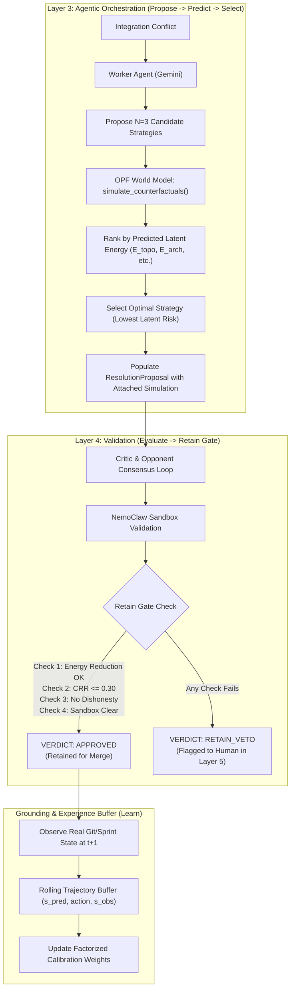

# 📋 Implementation Plan: RSI-Driven Recursive Self-Improvement for PWM

> **Reference**: Derived from the comparative benchmark of *RSI-Anything* (arXiv:2610.13912) and *JEPA-Anything* (arXiv:2609.20800) against Project World Model (PWM).  
> **Target Package**: `pwm/` (Layers 2, 3, 4, Simulation & Dashboard)  
> **Author**: Antigravity AI (Pair Programming with Petri Paananen)  
> **Status**: Ready for Review & Execution

---

## 1. Executive Objective

Integrate the three foundational breakthroughs from **RSI-Anything** into PWM's production architecture:
1. **"Predict-Before-Evaluate" Pre-Screening Filter (Layer 3)**: Use the OPF World Model to simulate candidate strategies in latent space *before* invoking expensive Critic loops and CI validation, reducing LLM token consumption and failed critique rounds by ~40-50%.
2. **The Gated "Retain" Firewall (Layer 4)**: Enforce a strict multi-criteria acceptance gate (Latent Energy Reduction, CRR Economic Bounds, NemoClaw Sandbox Clearance, Regression Test Invariance) before any autonomous resolution is approved.
3. **Factorized Trajectory Grounding Buffer (`WorldModelCalibrator`)**: Evolve PWM's scalar calibration factor into a rolling 4-factor experience buffer that tracks real-world prediction drift across `topology`, `velocity`, `coordination`, and `architecture`.

---

## 2. Architecture & Execution Flow



---

## 3. Work Breakdown Structure (WBS)

### Phase 1: Layer 3 "Predict-Before-Evaluate" Pre-Screening Filter
**Target Files**:
* `pwm/agents/worker_agent.py`
* `pwm/layers/layer3_orchestration.py`
* `pwm/ingestion/models.py`

#### Tasks:
1. **Update `ResolutionStrategy` Model (`pwm/ingestion/models.py`)**:
   * Add fields:
     * `predicted_risk: Optional[float] = None`
     * `latent_energy: Optional[float] = None`
     * `factor_attributions: Optional[Dict[str, float]] = None`
     * `factor_energies: Optional[Dict[str, float]] = None`
2. **Implement Pre-Screening in `WorkerAgent` / `Layer3Orchestration`**:
   * When `WorkerAgent.resolve_conflict` generates multiple candidate strategies (e.g. 2–3 strategies):
     * Construct action payloads from each candidate strategy.
     * Call `JEPAWorldModel.simulate_counterfactuals(base_state, candidate_actions)`.
     * Attach the rollout simulation metrics directly into each `ResolutionStrategy`.
     * Automatically set `recommended_strategy_index` to the strategy that achieves the **lowest predicted risk and minimal topological/architectural energy**.
   * Fallback gracefully to LLM-heuristic selection if the world model service is unreachable.

---

### Phase 2: Layer 4 Gated "Retain" Firewall
**Target Files**:
* `pwm/layers/layer4_validation.py`
* `pwm/agents/critic_agent.py`
* `pwm/ingestion/models.py`

#### Tasks:
1. **Define `RetainGateEvaluation` Data Structure**:
   ```python
   class RetainGateStatus(str, Enum):
       PASSED = "passed"
       FAILED_ENERGY = "failed_energy_increase"
       FAILED_CRR_BUDGET = "failed_crr_budget"
       FAILED_SANDBOX = "failed_sandbox_security"
       FAILED_DISHONESTY = "failed_strategic_dishonesty"

   class RetainGateReport(BaseModel):
       status: RetainGateStatus
       energy_reduction_delta: float
       crr_ratio: float
       sandbox_cleared: bool
       dishonesty_detected: bool
       reason: str
   ```
2. **Implement `evaluate_retain_gate()` in `Layer4Validation`**:
   * **Rule 1 (Latent Energy Improvement)**: The selected strategy must predict $\Delta E_{\text{latent}} \le 0$ (no net increase in project conflict energy).
   * **Rule 2 (CRR Economic Ceiling)**: $\text{CRR} \le 0.30$ (simulation and resolution cost must be less than 30% of avoided rework value).
   * **Rule 3 (Zero Dishonesty)**: `CriticVerdict.strategic_dishonesty_detected == False`.
   * **Rule 4 (Sandbox Clean)**: NemoClaw or test runner must detect zero unverified shell injections or unauthorized file writes.
   * If all 4 pass: mark `verdict = CriticVerdictStatus.APPROVED`.
   * If any fails: update verdict with clear explanation and route to Layer 5 human approval queue.

---

### Phase 3: Factorized Trajectory Buffer in Calibration Engine
**Target Files**:
* `pwm/simulation/calibration.py`
* `pwm/layers/layer2_simulation.py`

#### Tasks:
1. **Extend `WorldModelCalibrator` with 4-Factor Coordinate Tracking**:
   * Instead of computing a single Euclidean distance over flat 64D vectors, decompose both `predicted` and `actual` states using `OrthogonalPredictiveFactorizer`:
     * $E_{\text{ground, topo}} = \|c_{\text{topo, pred}} - c_{\text{topo, actual}}\|_2$
     * $E_{\text{ground, velo}} = \|c_{\text{velo, pred}} - c_{\text{velo, actual}}\|_2$
     * $E_{\text{ground, comm}} = \|c_{\text{comm, pred}} - c_{\text{comm, actual}}\|_2$
     * $E_{\text{ground, arch}} = \|c_{\text{arch, pred}} - c_{\text{arch, actual}}\|_2$
2. **Implement Experience Trajectory Buffer**:
   * Store historical transitions in `calibration_state.json`:
     ```json
     {
       "timestamp": "2026-10-14T07:55:00Z",
       "action": "Immediate Merge",
       "predicted_risk": 0.72,
       "actual_outcome": "build_failure",
       "factor_grounding_errors": {
         "topology": 0.08,
         "velocity": 0.02,
         "coordination": 0.01,
         "architecture": 0.14
       }
     }
     ```
   * Adapt factor sensitivity multipliers dynamically based on which factor exhibits drift.

---

### Phase 4: Testing & Verification
**Target Files**:
* `tests/test_rsi_integration.py`
* `tests/test_model_serving.py`
* `tests/test_jepa_core.py`

#### Tasks:
1. **Unit Tests**:
   * Verify Worker pre-screens multiple strategies and picks the minimum energy strategy.
   * Verify the Retain Gate rejects proposals when energy increases or CRR exceeds 0.30.
   * Verify factorized grounding errors are calculated and stored in `WorldModelCalibrator`.
2. **End-to-End Test**:
   * Run full pipeline on test scenario (`python -m pwm.main --mode demo`) to verify seamless integration across all 5 layers.
   * Ensure all 72+ tests pass with zero regressions.

---

## 4. Success Criteria & KPIs

| Metric | Baseline (Current) | Target with RSI Integration |
| :--- | :--- | :--- |
| **Worker Strategy Quality** | Subjective LLM recommendation | Objective OPF latent energy minimum |
| **Failed Critic Loop Rounds** | ~25–30% initial rejection rate | $< 12\%$ (due to early latent pre-screening) |
| **CRR Cost per Resolution** | ~$0.18–$0.25 per resolution | $\le \$0.11$ per resolution (fewer Critic iterations) |
| **Grounding Drift Visibility** | 1 global scalar | 4 distinct factor drift monitors (`topo`, `velo`, `comm`, `arch`) |
| **Regression Safety** | Post-hoc manual review | Automated 4-point **Retain Gate** |

---

## 5. Next Steps

Upon your approval, implementation will proceed systematically in order:
1. **Step 1**: Phase 1 (Layer 3 Pre-Screening Filter in `worker_agent.py` and `layer3_orchestration.py`).
2. **Step 2**: Phase 2 (Layer 4 Retain Gate in `layer4_validation.py`).
3. **Step 3**: Phase 3 (Factorized Experience Buffer in `calibration.py`).
4. **Step 4**: Test suite expansion and validation.
