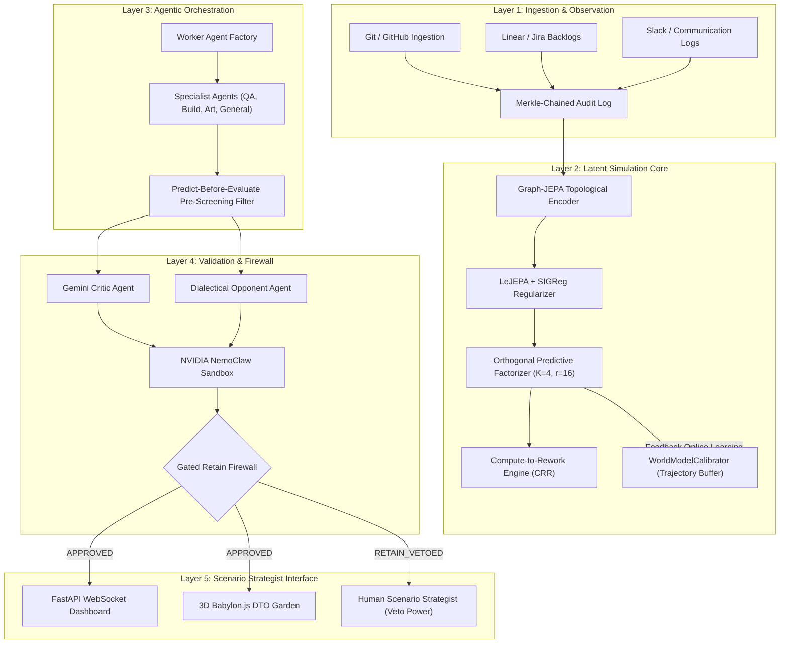

# 🌍 Project World Model (PWM) Framework

### Autonomous Causal Digital Twin & Self-Improving Multi-Agent Production Management

[](https://www.python.org/downloads/)
[](https://opensource.org/licenses/Apache-2.0)
[](tests/)
[](https://cloud.google.com/vertex-ai)
[](Docs/RSI_Anything_Review_and_PWM_Benchmark.md)
[](deploy.sh)

> **Stop reacting, start predicting.** Moving enterprise software production from association-level tracking (Agile / Scrum / Kanban) to self-calibrating, causal world model simulation.

---

## 📖 Theoretical Foundation & Academic Grounding

The **Project World Model (PWM)** framework solves the **"Paradox of Agility"**: the phenomenon where exponential code and asset generation by generative AI models creates massive, unmanageable **integration debt** that completely overwhelms linear, human-driven Scrum and Kanban workflows.

PWM resolves this by operating as a **Causal Digital Twin (CDT)**. Operating an asynchronous **24-hour Agent Verification Engine** (`AsyncThink`), PWM autonomously models, detects, simulates, and resolves integration debt across version control, sprint backlogs, and team communication before conflicts reach production.

### 🎓 Academic Research Foundation
The framework is conceptually and empirically validated by Petri Paananen's Master's Thesis:  
> **"Itseohjautuvat työnkulut videopeliteollisuudessa: tekoälyn maailmanmallit tuotannon johtamisen viitekehyksenä"**  
> *(English: "Emergent Workflows in the Video Game Industry: Leveraging AI World Models as a Framework for Production Management")*  
> Jyväskylä University of Applied Sciences (JAMK, 2026)  
> **Permanent URN**: [URN:NBN:fi:amk-2026052919003](https://urn.fi/URN:NBN:fi:amk-2026052919003)

---

## 🚀 What's New in PWM (Recent Major Innovations)

PWM has recently integrated state-of-the-art breakthroughs in non-generative self-supervised world models and recursive self-improvement:

### 1. ⚡ Orthogonal Predictive Factorization (OPF) — *JEPA-Anything* (arXiv:2609.20800)
Monolithic latent state representations risk entangling conflicting signals. PWM decomposes its 64-dimensional latent project state $s \in \mathbb{R}^{64}$ into $K=4$ orthogonal factor subspaces ($r=16$) with lossless orthonormal synthesis:
* **Topology** ($c_{\text{topology}}$): Graph connectivity, cyclic dependencies, PR-issue blast radius, code churn.
* **Velocity** ($c_{\text{velocity}}$): Sprint throughput, commit frequency, cycle time lag, WIP accumulation.
* **Coordination** ($c_{\text{coordination}}$): Developer handoffs, communication sentiment, cross-team blockers.
* **Architecture** ($c_{\text{architecture}}$): Interface rot, modular coupling, API boundary stability.
* **Guaranteed Geometry**: Includes automated Gram matrix audits ensuring $\|W W^T - I\|_F < 10^{-6}$ for true subspace independence.

### 2. 🔄 Recursive Self-Improvement (RSI) Engine — *RSI-Anything* (arXiv:2610.13912)
Embodying the closed-loop cycle `Propose → Predict → Select → Evaluate → Learn → Retain`:
* **"Predict-Before-Evaluate" Pre-Screening Filter (Layer 3)**: Candidate strategies generated by Worker agents are pre-simulated in OPF latent space *before* incurring LLM critique costs. The system objectively selects the strategy with lowest predicted risk and latent energy ($E = \|s' - s\|_2$).
* **Gated "Retain" Firewall (Layer 4)**: Enforces an automated 4-stage firewall before any proposal is retained:
  1. *Anti-Strategic Dishonesty*: Critic agent detects shortcut-taking or hidden complexity.
  2. *NVIDIA NemoClaw Sandbox Clearance*: Isolated micro-sandbox blocks unauthorized syscalls and privilege escalation.
  3. *Latent Risk Tolerance*: Rejects any intervention where predicted latent risk exceeds $0.90$.
  4. *CRR Economic Budget Ceiling*: Vetoes proposals if Compute-to-Rework Ratio exceeds $0.30$.
  Vetoed proposals transition to `RETAIN_VETOED` and are routed to human Scenario Strategists.
* **Factorized Experience Replay Buffer (Layer 2)**: Rolling 100-step transition buffer tracking factorized grounding errors with online gradient adaptation.

### 3. 🧠 Gemini 3 Thought Signature Circulation
Upgraded to support Google's **Gemini 3** family (`gemini-2.5-pro`, `gemini-2.5-flash`, and preview variants) with **Thought Signature Preservation**, allowing multi-turn debates between Worker, Critic, and Opponent agents to circulate internal reasoning chains without loss of nuance.

### 4. 🌐 Interactive 3D DTO Garden (Babylon.js Digital Twin)
An interactive 3D spatial digital twin built with Babylon.js and modular low-poly PBR assets:
* **Visual Conflict Mapping**: Integration debt appears as weathering boulders, sprint velocity as flowing fountains, and work packages as blossoming foliage.
* **Autonomous AI Gnome Avatars**: Real-time obstacle-avoiding agent statues navigating between work sockets with steering separation and deadlock recovery.
* **Dynamic Weather System**: Project stress maps directly to 3D weather (sunny clear skies for healthy low-risk sprints vs. stormy overcast skies during critical merge conflicts).
* **Live Mouseover Telemetry**: Raycast hover tooltips displaying real-time agent thought states, PR numbers, and risk scores.

### 5. 📊 Deterministic Flow & Stakeholder Analytics
* **Flow Metrics**: Automated Little's Law throughput, WIP drift analysis, cycle time percentiles, and bottleneck velocity flags.
* **Stakeholder Dynamics**: RACI matrix balance scoring, cognitive load indices, and cross-discipline communication friction detection.

---

## 🎨 5-Layer System Architecture



### Detailed Layer Breakdown

| Layer | Component | Core Responsibilities |
|---|---|---|
| **Layer 1: Observation** | `pwm.layers.layer1_observation` | Ingests Git commits, PRs, Linear/Jira tasks, Slack messages, and MS Project XML into a unified bipartite dependency graph with SHA-256 Merkle tamper-proofing. |
| **Layer 2: Simulation** | `pwm.layers.layer2_simulation` | Houses the `GraphJEPAEncoder`, `LeJEPASimulator` with SIGReg, `OrthogonalPredictiveFactorizer`, and `WorldModelCalibrator`. Computes counterfactual rollouts and tracks CRR budgets. |
| **Layer 3: Orchestration** | `pwm.layers.layer3_orchestration` | Decomposes debt items and runs the `AsyncThink` protocol. Uses the **Predict-Before-Evaluate** pre-screening filter to rank candidate strategies in latent space before evaluation. |
| **Layer 4: Validation** | `pwm.layers.layer4_validation` | Hosts the multi-agent consensus loop (Critic + Opponent + Artistic Integrity) and executes the **Gated Retain Firewall** with NemoClaw sandbox isolation. |
| **Layer 5: Interface** | `pwm.dashboard` | Real-time WebSocket web dashboard, 3D DTO Garden, CLI terminal HUD, and human-in-the-loop decision routing. |

---

## 🤖 The Multi-Agent Organization

PWM organizes its AI agents into three specialized functional tiers matching Thesis Kuvio 6 & 7:

```
                          ┌────────────────────────┐
                          │   Scenario Strategist  │ (Human-in-the-Loop)
                          └───────────┬────────────┘
                                      │ Overrides / Veto
                                      ▼
         ┌─────────────────────────────────────────────────────────┐
         │             Strategic & Flow Orchestration              │
         │  PlannerAgent  │  PortfolioAgent  │  StakeholderAgent   │
         │  ScrumMaster   │  KanbanFlow      │  BudgetGuard        │
         └───────────┬─────────────────────────────────┬───────────┘
                     │ Directives                      │ Audits
                     ▼                                 ▼
┌──────────────────────────────────────────┐   ┌───────────────────────────────┐
│        Specialist Worker Agents          │   │   Dialectical & Quality Guard │
│  MergeConflictWorker  │  QAWorker        │◄──┤  CriticAgent (Gemini 3 Pro)   │
│  BuildWorker          │  ArtIntegration  │   │  OpponentAgent (Devil's Adv)  │
│  GeneralWorkerAgent                      │   │  ArtisticIntegrityAgent       │
└──────────────────────────────────────────┘   └───────────────────────────────┘
```

* **Worker Agents**: Propose concrete code refactors, dependency updates, and branch integrations (`qa_agent.py`, `build_agent.py`, `art_agent.py`).
* **Critic Agent**: Detects logical flaws, anti-patterns, and **strategic dishonesty** (agents hiding bugs to pass CI).
* **Opponent Agent**: Dialectical devil's advocate challenging every proposal with worst-case scenario testing.
* **Artistic Integrity Agent**: Enforces visual and creative fidelity in creative and gaming software projects, ensuring AI optimizations do not strip human aesthetic soul.
* **Budget Guard Agent**: Monitors API token consumption and token-per-watt efficiency to prevent runaway expenses.

---

## 💰 Economic Justification: CRR Economics

A central tenet of the PWM framework is economic discipline. AI agents must never cost more than the human rework they prevent. PWM continuously computes the **Compute-to-Rework Ratio (CRR)**:

$$\text{CRR} = \frac{\text{Total AI Inference Cost (€)} + \text{Infrastructure & GPU Cost (€)}}{\text{Estimated Human Developer Rework Saved (€)}}$$

* **$\text{CRR} < 0.10$**: Exceptional efficiency (AI is 10x+ cheaper than manual firefighting).
* **$\text{CRR} \le 0.30$**: Target operating budget envelope.
* **$\text{CRR} > 0.30$**: Layer 4 Retain Firewall veto triggered (`FAILED_CRR_BUDGET`).
* **$\text{CRR} \ge 1.00$**: **Jevons Paradox Alert** — autonomous execution halted; requires explicit human executive override.

---

## ⚡ Model Serving & Hybrid Cloud Architecture

PWM uses a cost-optimized **Hybrid Serverless + On-Demand GPU** topology:

```
┌────────────────────────────────────────┐       ┌───────────────────────────────────────┐
│          Google Cloud Run              │       │       Google Compute Engine (GCE)     │
│       (Serverless Orchestration)       │       │            (On-Demand GPU VM)         │
│                                        │       │                                       │
│  • Web Dashboard & 3D DTO Garden       │ HTTP  │  • GraphJEPA Server (:8001)           │
│  • Layers 1, 3, 4, 5 Execution         ├──────►│  • JEPA World Model Server (:8000)    │
│  • Vertex AI Gemini 3 Gateway          │       │  • PointJEPA 3D Server (:8002)        │
│  • Scale-to-Zero (--min-instances=0)   │       │  • NVIDIA NemoClaw Sandbox (:8008)    │
└────────────────────────────────────────┘       └──────────────────┬────────────────────┘
                                                                    │
                                                 Automated Auto-Shutdown on Idle
```

* **Cloud Run Scale-to-Zero**: Containerized orchestration scale-to-zero (`--min-instances=0`) when no active users are connected, avoiding idle hosting charges.
* **On-Demand GPU Lifecycle**: `run_gpu_pipeline.py` starts the GPU VM via GCP API, waits for health checks, processes batched embeddings, and guarantees shutdown in a `finally` block.
* **Semantic Vertex AI Fallbacks**: If the GPU VM is offline, PWM seamlessly falls back to Gemini Pro/Flash semantic simulation with zero downtime.

---

## 💻 Quick Start & Local Execution

### 1. Prerequisites & Installation
```bash
# Clone the repository
git clone https://github.com/petripaananen/Project-World-Model.git
cd Project-World-Model

# Setup Python virtual environment
python -m venv .venv
source .venv/Scripts/activate  # Windows: .venv\Scripts\activate

# Install dependencies
pip install -r requirements.txt
```

### 2. Environment Configuration
Create a `.env` file in the project root:
```env
GOOGLE_API_KEY=your_gemini_api_key
GCP_PROJECT_ID=your-gcp-project-id
GCP_LOCATION=us-central1
NEMOCLAW_ENDPOINT_URL=http://localhost:8008/audit
JEPA_WM_ENDPOINT_URL=http://localhost:8000
```

### 3. Execution Commands

* **Run Interactive 3D DTO Web Dashboard** (Recommended):
  ```bash
  python -m pwm.main --web --port 8765
  ```
  Open `http://localhost:8765` to view the live dashboard and Babylon.js 3D Garden.

* **Run CLI Demo Mode** (Fully deterministic, no API keys required):
  ```bash
  python -m pwm.main --mode demo
  ```

* **Run Live Gemini 3 Agent Analysis**:
  ```bash
  python -m pwm.main --mode analyze
  ```

* **Run Continuous 24h Autonomous Loop**:
  ```bash
  python -m pwm.main --loop --interval 300
  ```

* **Simulate Specific Pre-Built Scenarios**:
  * Scenario 1 (Causal Counterfactual Simulation): `python -m pwm.main --scenario 1`
  * Scenario 2 (NemoClaw Sandbox Veto): `python -m pwm.main --scenario 2`
  * Scenario 3 (CRR Budget Alert & Jevons Defense): `python -m pwm.main --scenario 3`

* **Start the Standalone JEPA Model Serving Cluster**:
  ```bash
  python -m pwm.serving.runner --all
  ```

---

## 🧪 Automated Test Suite

PWM enforces a strict pre-deployment testing rule: all release commits must pass 100% of local unit and integration tests.

```bash
pytest tests/
```

### Test Coverage (81 Passed / 0 Failures):
* `test_rsi_integration.py`: Validates Layer 3 Predict-Before-Evaluate selection, Layer 4 Retain Gate veto conditions (dishonesty, sandbox, energy, CRR), and closed-loop trajectory recording.
* `test_jepa_core.py`: Asserts GraphJEPA topological embeddings, LeJEPA SIGReg regularization, and OPF Gram matrix orthonormality.
* `test_calibration.py`: Asserts self-supervised calibration factor updates, factorized grounding errors, and trajectory persistence.
* `test_new_agents.py`: Validates Worker, Critic, Opponent, and specialized agent consensus workflows.
* `test_security_adversarial.py`: Validates SAIF security posture, prompt injection resistance, and NemoClaw isolation.
* `test_budget_and_loop.py`: Validates CRR calculations, token budget enforcement, and debate loops.
* `test_agile_integration.py`: Tests deterministic Agile metrics (velocity, lead time, RACI, DoD compliance).
* `test_model_serving.py`: Tests FastAPI JEPA microservice endpoints (`/simulate`, `/encode-graph`, `/audit-geometry`).
* `test_gcp_config.py`: Verifies GCP configuration loading, GCE lifecycle management, and semantic fallbacks.
* `test_jira_ingest.py` & `test_linear_ingest.py`: Tests real-world issue tracker adapters.
* `test_ftue_parsers.py`: Verifies MS Project XML and Slack export parsers.

---

## 📚 Academic Citation & References

If you use or build upon the Project World Model framework in your academic research or enterprise engineering, please cite:

```bibtex
@mastersthesis{paananen2026pwm,
  author       = {Petri Paananen},
  title        = {Itseohjautuvat työnkulut videopeliteollisuudessa: tekoälyn maailmanmallit tuotannon johtamisen viitekehyksenä},
  school       = {Jyväskylä University of Applied Sciences (JAMK)},
  year         = {2026},
  type         = {Master's Thesis},
  url          = {https://urn.fi/URN:NBN:fi:amk-2026052919003}
}
```

### Key Literature & Architecture References:
1. **RSI-Anything**: Gen-Verse (2026). *RSI-Anything: Learning to Self-Improve World Models and Policies through Gated Retention*. arXiv:2610.13912.
2. **JEPA-Anything**: Gen-Verse (2026). *JEPA-Anything: Learning Predictive Models across Different Worlds*. arXiv:2609.20800.
3. **LeJEPA**: Balestriero, R., & LeCun, Y. (2025). *LeJEPA: Provable and Scalable Self-Supervised Learning Without Heuristics*. Meta AI Research.
4. **Google SAIF**: *Secure AI Framework: Standards for Agentic Risk Mitigation*. Google Cloud Security.

---

## 📄 License

This project is licensed under the **Apache License, Version 2.0**. See the [LICENSE](LICENSE) file for details.